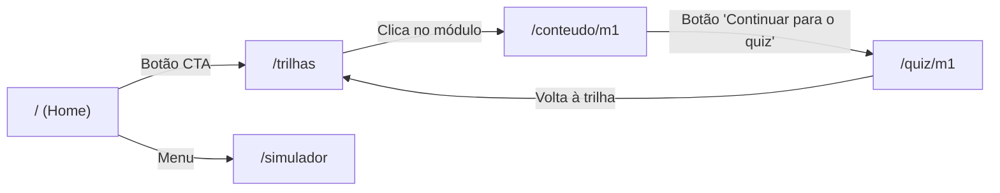
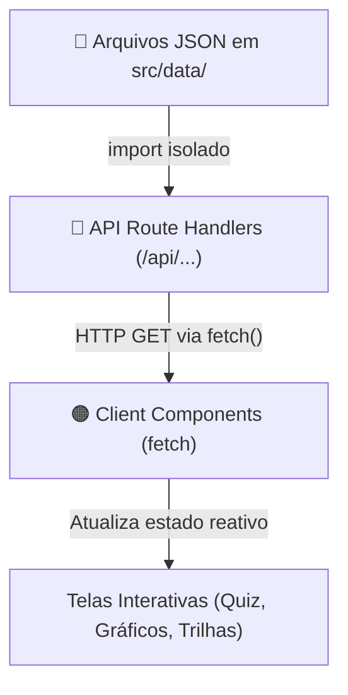
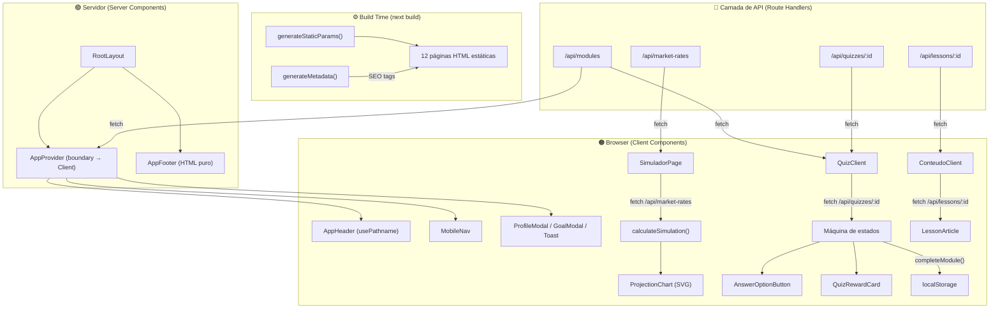

# Análise Completa da Arquitetura FinEdu — Next.js 16

> [!NOTE]
> Projeto construído com **Next.js 16.4.2**, **React 19.3.0**, usando o **App Router** (`src/app/`). Zero dependências externas além do core React/Next.

---

## 1. Server Components vs Client Components

No Next.js App Router, **todo componente é Server Component por padrão**, a menos que declare `"use client"` na primeira linha. Essa separação é o pilar da arquitetura do FinEdu.

### Mapa completo: Servidor × Cliente

```
🟢 = Server Component (renderizado no servidor)
🟠 = Client Component ("use client" — renderizado no cliente)
```

| Arquivo | Tipo | Diretiva |
|---------|------|----------|
| **Pages (Rotas)** | | |
| [`layout.js`](file:///Users/luigigiarola/Downloads/Projeto-Site---WEB-MOBILE-main/src/app/layout.js) | 🟢 Server | — |
| [`page.js`](file:///Users/luigigiarola/Downloads/Projeto-Site---WEB-MOBILE-main/src/app/page.js) (Home) | 🟢 Server | — |
| [`trilhas/page.js`](file:///Users/luigigiarola/Downloads/Projeto-Site---WEB-MOBILE-main/src/app/trilhas/page.js) | 🟢 Server | — |
| [`quiz/[moduloId]/page.js`](file:///Users/luigigiarola/Downloads/Projeto-Site---WEB-MOBILE-main/src/app/quiz/[moduloId]/page.js) | 🟢 Server | — |
| [`conteudo/[moduloId]/page.js`](file:///Users/luigigiarola/Downloads/Projeto-Site---WEB-MOBILE-main/src/app/conteudo/[moduloId]/page.js) | 🟢 Server | — |
| [`simulador/page.js`](file:///Users/luigigiarola/Downloads/Projeto-Site---WEB-MOBILE-main/src/app/simulador/page.js) | 🟠 Client | `"use client"` |
| **Context** | | |
| [`AppContext.js`](file:///Users/luigigiarola/Downloads/Projeto-Site---WEB-MOBILE-main/src/context/AppContext.js) | 🟠 Client | `"use client"` |
| **Layout Components** | | |
| [`AppHeader.js`](file:///Users/luigigiarola/Downloads/Projeto-Site---WEB-MOBILE-main/src/components/layout/AppHeader.js) | 🟠 Client | `"use client"` |
| [`AppFooter.js`](file:///Users/luigigiarola/Downloads/Projeto-Site---WEB-MOBILE-main/src/components/layout/AppFooter.js) | 🟢 Server | — |
| [`MobileNav.js`](file:///Users/luigigiarola/Downloads/Projeto-Site---WEB-MOBILE-main/src/components/layout/MobileNav.js) | 🟠 Client | `"use client"` |
| [`ProfileModal.js`](file:///Users/luigigiarola/Downloads/Projeto-Site---WEB-MOBILE-main/src/components/layout/ProfileModal.js) | 🟠 Client | `"use client"` |
| [`GoalModal.js`](file:///Users/luigigiarola/Downloads/Projeto-Site---WEB-MOBILE-main/src/components/layout/GoalModal.js) | 🟠 Client | `"use client"` |
| [`ToastNotification.js`](file:///Users/luigigiarola/Downloads/Projeto-Site---WEB-MOBILE-main/src/components/layout/ToastNotification.js) | 🟠 Client | `"use client"` |
| **Home** | | |
| [`HomeHero.js`](file:///Users/luigigiarola/Downloads/Projeto-Site---WEB-MOBILE-main/src/components/features/home/HomeHero.js) | 🟠 Client | `"use client"` |
| [`GoalsSection.js`](file:///Users/luigigiarola/Downloads/Projeto-Site---WEB-MOBILE-main/src/components/features/home/GoalsSection.js) | 🟠 Client | `"use client"` |
| [`GoalItem.js`](file:///Users/luigigiarola/Downloads/Projeto-Site---WEB-MOBILE-main/src/components/features/home/GoalItem.js) | 🟠 Client | `"use client"` |
| [`EmptyGoalsState.js`](file:///Users/luigigiarola/Downloads/Projeto-Site---WEB-MOBILE-main/src/components/features/home/EmptyGoalsState.js) | 🟢 Server | — |
| [`YieldComparisonCard.js`](file:///Users/luigigiarola/Downloads/Projeto-Site---WEB-MOBILE-main/src/components/features/home/YieldComparisonCard.js) | 🟠 Client | `"use client"` |
| **Simulador** | | |
| [`SimulatorHeader.js`](file:///Users/luigigiarola/Downloads/Projeto-Site---WEB-MOBILE-main/src/components/features/simulador/SimulatorHeader.js) | 🟢 Server | — |
| [`SimulationForm.js`](file:///Users/luigigiarola/Downloads/Projeto-Site---WEB-MOBILE-main/src/components/features/simulador/SimulationForm.js) | 🟠 Client | `"use client"` |
| [`SimulationResultCard.js`](file:///Users/luigigiarola/Downloads/Projeto-Site---WEB-MOBILE-main/src/components/features/simulador/SimulationResultCard.js) | 🟠 Client | `"use client"` |
| [`ProjectionChart.js`](file:///Users/luigigiarola/Downloads/Projeto-Site---WEB-MOBILE-main/src/components/features/simulador/ProjectionChart.js) | 🟠 Client | `"use client"` |
| [`StatsGrid.js`](file:///Users/luigigiarola/Downloads/Projeto-Site---WEB-MOBILE-main/src/components/features/simulador/StatsGrid.js) | 🟢 Server | — |
| [`CompoundInterestExplainer.js`](file:///Users/luigigiarola/Downloads/Projeto-Site---WEB-MOBILE-main/src/components/features/simulador/CompoundInterestExplainer.js) | 🟢 Server | — |
| **Quiz** | | |
| [`QuizClient.js`](file:///Users/luigigiarola/Downloads/Projeto-Site---WEB-MOBILE-main/src/components/features/quiz/QuizClient.js) | 🟠 Client | `"use client"` |
| [`QuizHeader.js`](file:///Users/luigigiarola/Downloads/Projeto-Site---WEB-MOBILE-main/src/components/features/quiz/QuizHeader.js) | 🟢 Server | — |
| [`QuizBreadcrumb.js`](file:///Users/luigigiarola/Downloads/Projeto-Site---WEB-MOBILE-main/src/components/features/quiz/QuizBreadcrumb.js) | 🟢 Server | — |
| [`QuizStepper.js`](file:///Users/luigigiarola/Downloads/Projeto-Site---WEB-MOBILE-main/src/components/features/quiz/QuizStepper.js) | 🟢 Server | — |
| [`QuizQuestion.js`](file:///Users/luigigiarola/Downloads/Projeto-Site---WEB-MOBILE-main/src/components/features/quiz/QuizQuestion.js) | 🟠 Client | `"use client"` |
| [`AnswerGroup.js`](file:///Users/luigigiarola/Downloads/Projeto-Site---WEB-MOBILE-main/src/components/features/quiz/AnswerGroup.js) | 🟠 Client | `"use client"` |
| [`AnswerOptionButton.js`](file:///Users/luigigiarola/Downloads/Projeto-Site---WEB-MOBILE-main/src/components/features/quiz/AnswerOptionButton.js) | 🟠 Client | `"use client"` |
| [`QuizFeedbackPanel.js`](file:///Users/luigigiarola/Downloads/Projeto-Site---WEB-MOBILE-main/src/components/features/quiz/QuizFeedbackPanel.js) | 🟠 Client | `"use client"` |
| [`QuizRewardCard.js`](file:///Users/luigigiarola/Downloads/Projeto-Site---WEB-MOBILE-main/src/components/features/quiz/QuizRewardCard.js) | 🟠 Client | `"use client"` |
| **Trilhas** | | |
| [`TrailHeader.js`](file:///Users/luigigiarola/Downloads/Projeto-Site---WEB-MOBILE-main/src/components/features/trilhas/TrailHeader.js) | 🟠 Client | `"use client"` |
| [`PhaseFilterBar.js`](file:///Users/luigigiarola/Downloads/Projeto-Site---WEB-MOBILE-main/src/components/features/trilhas/PhaseFilterBar.js) | 🟠 Client | `"use client"` |
| [`TrailMap.js`](file:///Users/luigigiarola/Downloads/Projeto-Site---WEB-MOBILE-main/src/components/features/trilhas/TrailMap.js) | 🟠 Client | `"use client"` |
| [`TrailNodeCard.js`](file:///Users/luigigiarola/Downloads/Projeto-Site---WEB-MOBILE-main/src/components/features/trilhas/TrailNodeCard.js) | 🟠 Client | `"use client"` |
| **Conteúdo** | | |
| [`ConteudoClient.js`](file:///Users/luigigiarola/Downloads/Projeto-Site---WEB-MOBILE-main/src/components/features/conteudo/ConteudoClient.js) | 🟠 Client | `"use client"` |
| [`FocusHeader.js`](file:///Users/luigigiarola/Downloads/Projeto-Site---WEB-MOBILE-main/src/components/features/conteudo/FocusHeader.js) | 🟢 Server | — |
| [`FocusFooter.js`](file:///Users/luigigiarola/Downloads/Projeto-Site---WEB-MOBILE-main/src/components/features/conteudo/FocusFooter.js) | 🟢 Server | — |
| [`LessonArticle.js`](file:///Users/luigigiarola/Downloads/Projeto-Site---WEB-MOBILE-main/src/components/features/conteudo/LessonArticle.js) | 🟢 Server | — |
| **UI Primitivos** | | |
| [`Badge.js`](file:///Users/luigigiarola/Downloads/Projeto-Site---WEB-MOBILE-main/src/components/ui/Badge.js) | 🟢 Server | — |
| [`Button.js`](file:///Users/luigigiarola/Downloads/Projeto-Site---WEB-MOBILE-main/src/components/ui/Button.js) | 🟠 Client | `"use client"` |
| [`Card.js`](file:///Users/luigigiarola/Downloads/Projeto-Site---WEB-MOBILE-main/src/components/ui/Card.js) | 🟢 Server | — |
| [`ProgressBar.js`](file:///Users/luigigiarola/Downloads/Projeto-Site---WEB-MOBILE-main/src/components/ui/ProgressBar.js) | 🟢 Server | — |
| **API (Route Handlers)** | | |
| [`modules/route.js`](file:///Users/luigigiarola/Downloads/Projeto-Site---WEB-MOBILE-main/src/app/api/modules/route.js) | ⚡ API Route | GET /api/modules |
| [`lessons/route.js`](file:///Users/luigigiarola/Downloads/Projeto-Site---WEB-MOBILE-main/src/app/api/lessons/route.js) | ⚡ API Route | GET /api/lessons |
| [`lessons/[moduloId]/route.js`](file:///Users/luigigiarola/Downloads/Projeto-Site---WEB-MOBILE-main/src/app/api/lessons/[moduloId]/route.js) | ⚡ API Route | GET /api/lessons/:moduloId |
| [`quizzes/route.js`](file:///Users/luigigiarola/Downloads/Projeto-Site---WEB-MOBILE-main/src/app/api/quizzes/route.js) | ⚡ API Route | GET /api/quizzes |
| [`quizzes/[moduloId]/route.js`](file:///Users/luigigiarola/Downloads/Projeto-Site---WEB-MOBILE-main/src/app/api/quizzes/[moduloId]/route.js) | ⚡ API Route | GET /api/quizzes/:moduloId |
| [`market-rates/route.js`](file:///Users/luigigiarola/Downloads/Projeto-Site---WEB-MOBILE-main/src/app/api/market-rates/route.js) | ⚡ API Route | GET /api/market-rates |
| **Lib/Utilitários** | | |
| [`calculations.js`](file:///Users/luigigiarola/Downloads/Projeto-Site---WEB-MOBILE-main/src/lib/calculations.js) | ⚪ Módulo puro | Sem diretiva (funções utilitárias, sem JSX) |

### Contagem final

| | Quantidade |
|---|---|
| 🟢 **Server Components** | **16** |
| 🟠 **Client Components** | **26** |
| ⚡ **API Route Handlers** | **6** |
| ⚪ **Módulo utilitário** | **1** |

---

## 2. Papel de Cada Tipo no JavaScript

### 🟢 Server Components — O que fazem

Os Server Components **executam exclusivamente no servidor** durante o build ou no momento da requisição. Seu JavaScript **nunca é enviado ao navegador**.

**Responsabilidades no FinEdu:**

| Papel | Exemplos no projeto |
|-------|-------------------|
| **Definir metadados SEO** (`metadata`, `generateMetadata`) | `page.js` (Home), `trilhas/page.js`, `quiz/[moduloId]/page.js`, `conteudo/[moduloId]/page.js` |
| **Pré-renderizar HTML estático** (SSG) | `conteudo/[moduloId]/page.js` gera o artigo completo como HTML puro |
| **Gerar rotas dinâmicas em build** (`generateStaticParams`) | `quiz/[moduloId]/page.js` e `conteudo/[moduloId]/page.js` geram as 6 variantes estáticas (m1–m6) |
| **Renderizar markup estático sem interatividade** | `AppFooter`, `EmptyGoalsState`, `SimulatorHeader`, `CompoundInterestExplainer`, `FocusHeader`, `FocusFooter`, `LessonArticle`, `QuizHeader`, `QuizBreadcrumb`, `QuizStepper` |
| **Compor a estrutura de layout** | `layout.js` (RootLayout) define `<html>`, fontes, `<body>`, e orquestra o `AppProvider` |

> [!IMPORTANT]
> O `layout.js` é um Server Component, mas **importa** Client Components como `AppHeader`, `MobileNav`, `ProfileModal` etc. Isso é válido: o servidor renderiza a casca e os Client Components são "ilhas" de interatividade dentro dela.

**Vantagens concretas no projeto:**
- A página `/conteudo/m1` tem casca estática — o HTML base é gerado no build
- Os metadados de SEO (Open Graph, `<title>`) são resolvidos no servidor, garantindo indexação por buscadores
- Componentes como `AppFooter` (texto "© 2026 FinEdu...") não adicionam **nenhum byte** ao bundle JS do cliente

---

### 🟠 Client Components — O que fazem

Os Client Components declaram `"use client"` e têm seu JavaScript **enviado ao navegador**. Podem usar hooks (`useState`, `useEffect`, `useContext`), event handlers e APIs do DOM/browser.

**Responsabilidades no FinEdu:**

| Papel | Exemplos no projeto |
|-------|-------------------|
| **Gerenciar estado global** (Context + localStorage) | `AppContext.js` — persiste progresso, metas, nome do usuário |
| **Interatividade de formulários** | `SimulationForm.js` — sliders e inputs numéricos com `onChange` reativo |
| **Cálculos reativos em tempo real** | `SimuladorPage` — `useMemo(() => calculateSimulation(params, rates))` recalcula a cada mudança |
| **Renderização dinâmica de SVG** | `ProjectionChart.js` — desenha curvas vetoriais baseadas nos `dataPoints` |
| **Máquina de estados do Quiz** | `QuizClient.js` — controla pergunta atual, resposta selecionada, feedback, pontuação e fluxo de conclusão |
| **Feedback visual reativo** | `AnswerOptionButton.js` — muda cor (verde/vermelho) ao clicar |
| **Navegação ativa** (highlight da rota atual) | `AppHeader.js` e `MobileNav.js` — usam `usePathname()` |
| **Modais e notificações** | `ProfileModal`, `GoalModal`, `ToastNotification` — abrem/fecham via estado do Context |
| **Leitura de dados do browser** | `AppContext.js` — `useEffect` para `localStorage.getItem/setItem` |

> [!TIP]
> O projeto usa uma boa prática: componentes "folha" puramente visuais como `QuizBreadcrumb`, `QuizStepper`, `StatsGrid`, `CompoundInterestExplainer` são mantidos como Server Components — mesmo sendo filhos de Client Components — evitando inflacionar o bundle JS.

---

## 3. Sistema de Roteamento

O projeto usa o **App Router** do Next.js (diretório `src/app/`), baseado em **file-system routing**:

```
src/app/
├── layout.js              → RootLayout (envolve TODAS as páginas)
├── page.js                → Rota: /
├── globals.css
├── simulador/
│   └── page.js            → Rota: /simulador
├── trilhas/
│   └── page.js            → Rota: /trilhas
├── quiz/
│   └── [moduloId]/
│       └── page.js        → Rota: /quiz/m1, /quiz/m2, ... /quiz/m6
├── conteudo/
│   └── [moduloId]/
│       └── page.js        → Rota: /conteudo/m1, /conteudo/m2, ... /conteudo/m6
└── api/                   → Camada de API REST interna
    ├── modules/route.js
    ├── lessons/
    ├── quizzes/
    └── market-rates/route.js
```

### Tipos de rotas

| Rota | Tipo | Estratégia de Renderização |
|------|------|--------------------------|
| `/` | Estática | **SSG** — Server Component, metadata exportada, filhos Client |
| `/simulador` | Dinâmica (cliente) | **CSR** — `"use client"` na `page.js`, toda interação é no browser |
| `/trilhas` | Estática | **SSG** — Server Component, filhos Client leem dados do contexto |
| `/quiz/[moduloId]` | Estática com params | **SSG** — `generateStaticParams()` gera 6 páginas no build (m1–m6) |
| `/conteudo/[moduloId]` | Estática com params | **SSG** — `generateStaticParams()` gera 6 páginas no build (m1–m6) |

### Rotas Dinâmicas (`[moduloId]`)

As duas rotas dinâmicas (`/quiz/[moduloId]` e `/conteudo/[moduloId]`) usam `generateStaticParams()` para **pré-gerar todas as variantes no build**:

```javascript
// quiz/[moduloId]/page.js e conteudo/[moduloId]/page.js
export async function generateStaticParams() {
  return [
    { moduloId: "m1" },
    { moduloId: "m2" },
    { moduloId: "m3" },
    { moduloId: "m4" },
    { moduloId: "m5" },
    { moduloId: "m6" },
  ];
}
```

Isso significa que o Next.js gera **12 páginas HTML estáticas** (6 quiz + 6 conteúdo) durante `next build`.

### Fluxo de Navegação do Usuário



### Layout Compartilhado

O [`layout.js`](file:///Users/luigigiarola/Downloads/Projeto-Site---WEB-MOBILE-main/src/app/layout.js) envolve **todas** as páginas com uma estrutura fixa:

```
┌──────────────────────────────────┐
│         AppHeader (Client)       │  ← Navegação desktop + avatar
├──────────────────────────────────┤
│                                  │
│    <main>{children}</main>       │  ← Conteúdo da rota ativa
│                                  │
├──────────────────────────────────┤
│         MobileNav (Client)       │  ← Barra inferior (mobile)
├──────────────────────────────────┤
│         AppFooter (Server)       │  ← Rodapé fixo estático
├──────────────────────────────────┤
│  ProfileModal / GoalModal / Toast│  ← Modais em standby (Client)
└──────────────────────────────────┘
```

O `AppProvider` (Context) envolve tudo dentro do `<body>`, permitindo que **qualquer componente Client** acesse o estado global via `useApp()`.

---

## 4. API com Arquivos JSON e Consumo via `fetch()`

Os dados da aplicação são expostos por **Route Handlers** no Next.js e consumidos estritamente via `fetch()`:



### Arquivos de dados e endpoints correspondentes

| Arquivo JSON | Endpoint da API | Consumidores Frontend (via `fetch()`) |
|-------------|-----------------|---------------------------------------|
| [`modules.json`](file:///Users/luigigiarola/Downloads/Projeto-Site---WEB-MOBILE-main/src/data/modules.json) | `/api/modules` | `AppContext.js`, `TrailMap.js`, `QuizClient.js`, `ConteudoClient.js` |
| [`lessons.json`](file:///Users/luigigiarola/Downloads/Projeto-Site---WEB-MOBILE-main/src/data/lessons.json) | `/api/lessons/[moduloId]` | `ConteudoClient.js` |
| [`quizzes.json`](file:///Users/luigigiarola/Downloads/Projeto-Site---WEB-MOBILE-main/src/data/quizzes.json) | `/api/quizzes/[moduloId]` | `QuizClient.js` |
| [`marketRates.json`](file:///Users/luigigiarola/Downloads/Projeto-Site---WEB-MOBILE-main/src/data/marketRates.json) | `/api/market-rates` | `YieldComparisonCard.js`, `SimuladorPage` |

### Persistência de dados do usuário

O projeto usa **`localStorage`** como camada de persistência no cliente, gerenciada pelo [`AppContext.js`](file:///Users/luigigiarola/Downloads/Projeto-Site---WEB-MOBILE-main/src/context/AppContext.js):

```javascript
const STORAGE_KEY = "finanedu-progress-v1";
// Estrutura salva:
{
  name: "Luigi",           // Nome do usuário
  goals: [...],            // Metas financeiras pessoais
  completed: ["m1", "m2"], // IDs dos módulos concluídos
  results: {               // Resultado de cada quiz
    "m1": { score: 3, total: 3, passed: true, updatedAt: "..." }
  }
}
```

---

## 5. Resumo Visual da Arquitetura



---

## 6. Configuração Next.js

O [`next.config.mjs`](file:///Users/luigigiarola/Downloads/Projeto-Site---WEB-MOBILE-main/next.config.mjs) é minimalista:

```javascript
const nextConfig = {
  cacheComponents: true,     // Cache de Server Components para reusar entre requisições
  partialPrefetching: true,  // Prefetch parcial de rotas para navegação instantânea
};

export default nextConfig;
```

**Dependências** (do [`package.json`](file:///Users/luigigiarola/Downloads/Projeto-Site---WEB-MOBILE-main/package.json)):
- `next@16.4.2`
- `react@19.3.0`
- `react-dom@19.3.0`
- Zero dependências externas de UI, estado ou bibliotecas de gráficos — tudo construído em React puro, CSS Modules e SVG dinâmico.

