# FinEdu — Arquitetura e Fluxograma de Componentes

Este documento apresenta a visão visual e estrutural de como os componentes React e Next.js interagem na aplicação **FinEdu**, destacando a hierarquia de renderização do **Simulador de Investimentos**, do **Quiz Gamificado** e da **Leitura de Conteúdo**, integrados à camada de **API REST consumida via `fetch()`**.

---

## 1. Fluxograma Sequencial de Chamadas (Mermaid)

```mermaid
flowchart TD
    %% CAMADA DE DADOS E API
    subgraph API ["0. Camada de API REST (Route Handlers)"]
        API_MOD["GET /api/modules"]
        API_RATES["GET /api/market-rates"]
        API_QUIZ["GET /api/quizzes/[moduloId]"]
        API_LESSON["GET /api/lessons/[moduloId]"]
    end

    %% LAYOUT SHELL
    subgraph LAYOUT ["1. Shell Global da Aplicação (layout.js)"]
        A["RootLayout (src/app/layout.js)"] --> B["AppProvider (src/context/AppContext.js)"]
        B -.->|"fetch()"| API_MOD
        B --> C["AppHeader (Logo, links e perfil)"]
        B --> D["Navegação de Rota (<main>)"]
        B --> E["MobileNav (Barra inferior mobile)"]
        B --> F["AppFooter (Rodapé institucional)"]
        B --> G["Modais (ProfileModal / GoalModal / Toast)"]
    end

    %% DIRECIONAMENTO DE ROTAS
    D -->|"Acesso a /simulador"| SIM_PAGE["SimuladorPage (src/app/simulador/page.js)"]
    D -->|"Acesso a /quiz/[moduloId]"| QUIZ_SERVER["QuizPage Server (src/app/quiz/[moduloId]/page.js)"]
    D -->|"Acesso a /conteudo/[moduloId]"| CONT_SERVER["ConteudoPage Server (src/app/conteudo/[moduloId]/page.js)"]

    %% SIMULADOR
    subgraph SIMULADOR ["2. Sequência do Simulador (/simulador)"]
        SIM_PAGE -.->|"fetch()"| API_RATES
        SIM_PAGE --> SIM_HEAD["SimulatorHeader"]
        SIM_HEAD --> SIM_CARD_H["Card (UI)"]

        SIM_PAGE --> SIM_FORM["SimulationForm (Inputs numéricos)"]
        SIM_FORM -->|"Dispara onChangeParam + rates"| SIM_CALC["calculateSimulation(params, rates) (src/lib/calculations.js)"]
        SIM_FORM --> SIM_BTN["Button ('SIMULAR AGORA')"]

        SIM_CALC -->|"Atualiza pontos de dados"| SIM_RES["SimulationResultCard"]
        SIM_RES --> SIM_TOTAL["output#totalResult (Valor estimado)"]
        SIM_RES --> SIM_CHART["ProjectionChart (Curvas SVG em tempo real)"]
        SIM_RES --> SIM_STATS["StatsGrid (Total investido, rendimento e taxa mensal)"]
        SIM_RES --> SIM_EXP["CompoundInterestExplainer (Accordion <details>)"]
    end

    %% QUIZ
    subgraph QUIZ ["3. Sequência do Quiz (/quiz/[moduloId])"]
        QUIZ_SERVER -->|"moduloId"| QUIZ_CLIENT["QuizClient (src/components/features/quiz/QuizClient.js)"]
        QUIZ_CLIENT -.->|"fetch()"| API_QUIZ
        QUIZ_CLIENT -.->|"fetch()"| API_MOD
        
        QUIZ_CLIENT --> COND{"isFinished?"}

        %% Fluxo de Pergunta Ativa
        COND -->|"Não (Perguntas Ativas)"| Q_HEAD["QuizHeader (Botão fechar e posição 1/3)"]
        Q_HEAD --> Q_BAR["ProgressBar (UI)"]
        
        QUIZ_CLIENT --> Q_CRUMB["QuizBreadcrumb (Fase > Módulo > Quiz)"]
        QUIZ_CLIENT --> Q_STEP["QuizStepper (Bolinhas indicadoras de progresso)"]
        
        QUIZ_CLIENT --> Q_QUEST["QuizQuestion (Card do enunciado)"]
        Q_QUEST --> Q_GRP["AnswerGroup (Lista de opções)"]
        Q_GRP --> Q_OPT["AnswerOptionButton (A, B, C, D reativos: Verde / Vermelho)"]

        QUIZ_CLIENT --> Q_FEED["QuizFeedbackPanel (Faixa com explicação da resposta)"]
        QUIZ_CLIENT --> Q_NEXT["Button ('Próxima' ou 'Ver resultado')"]
        
        Q_NEXT -->|"Ao responder 3ª pergunta"| Q_FINISH["completeModule(moduloId, score) em AppContext"]
        Q_FINISH -->|"Atualiza localStorage e libera próxima aula"| COND

        %% Fluxo de Conclusão
        COND -->|"Sim (Concluído)"| Q_REW["QuizRewardCard (Tela de Celebração)"]
        Q_REW --> Q_CARD_R["Card (UI)"]
        Q_REW --> Q_SCORE["scoreRate ('3 de 3 acertos')"]
        Q_REW --> Q_ACTION["Button ('Voltar à trilha' ou 'Tentar novamente')"]
    end

    %% CONTEUDO
    subgraph CONTEUDO ["4. Sequência de Conteúdo / Aula (/conteudo/[moduloId])"]
        CONT_SERVER -->|"moduloId"| CONT_CLIENT["ConteudoClient (src/components/features/conteudo/ConteudoClient.js)"]
        CONT_CLIENT -.->|"fetch()"| API_LESSON
        CONT_CLIENT -.->|"fetch()"| API_MOD
        CONT_CLIENT --> C_HEAD["FocusHeader (Passo X de Y)"]
        CONT_CLIENT --> C_ART["LessonArticle (Texto e destaques conceituais)"]
        CONT_CLIENT --> C_FOOT["FocusFooter (Botão 'Continuar para o quiz')"]
    end

    %% ESTILOS
    classDef layout fill:#eef2ff,stroke:#6366f1,stroke-width:2px;
    classDef sim fill:#ecfdf5,stroke:#10b981,stroke-width:2px;
    classDef quiz fill:#fffbeb,stroke:#f59e0b,stroke-width:2px;
    classDef cont fill:#f0f9ff,stroke:#0284c7,stroke-width:2px;
    classDef api fill:#faf5ff,stroke:#a855f7,stroke-width:2px;
    classDef action fill:#edeaff,stroke:#6654e8,stroke-width:2px;

    class A,B,C,D,E,F,G layout;
    class SIM_PAGE,SIM_HEAD,SIM_CARD_H,SIM_FORM,SIM_CALC,SIM_RES,SIM_TOTAL,SIM_CHART,SIM_STATS,SIM_EXP sim;
    class QUIZ_SERVER,QUIZ_CLIENT,Q_HEAD,Q_CRUMB,Q_STEP,Q_QUEST,Q_GRP,Q_OPT,Q_FEED,Q_REW,Q_CARD_R,Q_SCORE quiz;
    class CONT_SERVER,CONT_CLIENT,C_HEAD,C_ART,C_FOOT cont;
    class API_MOD,API_RATES,API_QUIZ,API_LESSON api;
    class SIM_BTN,Q_NEXT,Q_ACTION,Q_BAR,Q_FINISH action;
```

---

## 2. Detalhamento dos Componentes

### A. Simulador de Investimentos (`/simulador`)
| Componente | Tipo | Responsabilidade |
| :--- | :--- | :--- |
| **`SimuladorPage`** | Client Component | Realiza `fetch('/api/market-rates')`, gerencia os parâmetros (`initial`, `monthly`, `annualRate`, `years`) e aciona o cálculo com `useMemo`. |
| **`SimulatorHeader`** | UI Feature | Apresenta o título da ferramenta, subtítulo explicativo e ícone temático dentro de um `Card`. |
| **`SimulationForm`** | Client Component | Agrupa os inputs de controle numérico e dispara os eventos de alteração (`onChangeParam`). |
| **`SimulationResultCard`** | UI Feature | Painel consolidado que exibe o total final estimado e acopla a visualização gráfica e analítica. |
| **`ProjectionChart`** | SVG Component | Gráfico vetorial leve e responsivo que traça as três curvas comparativas (Projeção do Usuário, CDI e Poupança). |
| **`StatsGrid`** | UI Feature | Grade com os três cartões de resumo analítico (Total aportado, Lucro em rendimentos e Taxa mensal efetiva). |
| **`CompoundInterestExplainer`** | UI Element | Bloco sanfona (`
`) com a fundamentação conceitual de juros compostos. |

### B. Módulo de Quiz (`/quiz/[moduloId]`)
| Componente | Tipo | Responsabilidade |
| :--- | :--- | :--- |
| **`QuizPage`** | Server Component | Extrai o parâmetro dinâmico da URL e aplica `generateStaticParams()` para gerar as rotas estáticas antecipadamente. |
| **`QuizClient`** | Client Component | Executa `fetch('/api/quizzes/[moduloId]')` e `fetch('/api/modules')`, orquestrando a máquina de estados do questionário. |
| **`QuizHeader`** | UI Feature | Cabeçalho com botão de abandono (`×`), barra de progresso percentual (`ProgressBar`) e contador numérico (`1/3`). |
| **`QuizBreadcrumb`** | UI Element | Trilha de navegação contextual (`Fase` > `Módulo` > `Quiz rápido`). |
| **`QuizStepper`** | UI Element | Marcadores circulares sequenciais que indicam quais questões já foram superadas e qual está ativa. |
| **`QuizQuestion`** | UI Feature | Cartão que exibe o enunciado da pergunta e envelopa o grupo de alternativas. |
| **`AnswerGroup`** | UI Feature | Lista vertical contendo as alternativas da questão atual. |
| **`AnswerOptionButton`** | Client Component | Botão de opção reativo que destaca em verde o acerto ou vermelho o erro após a escolha, bloqueando novas interações. |
| **`QuizFeedbackPanel`** | UI Feature | Faixa explicativa que surge após a resposta exibindo a dica pedagógica e fundamentação da alternativa. |
| **`QuizRewardCard`** | UI Feature | Tela de celebração que surge ao término do quiz, informando a pontuação obtida e liberando o próximo módulo na trilha. |

### C. Módulo de Conteúdo / Leitura (`/conteudo/[moduloId]`)
| Componente | Tipo | Responsabilidade |
| :--- | :--- | :--- |
| **`ConteudoPage`** | Server Component | Página servidora que provê metadados dinâmicos e delega a renderização para `ConteudoClient`. |
| **`ConteudoClient`** | Client Component | Dispara `fetch('/api/lessons/[moduloId]')` e `fetch('/api/modules')` em paralelo, gerenciando estados de carregamento e erro. |
| **`FocusHeader`** | UI Feature | Cabeçalho focado contendo botão de retorno à trilha e indicador numérico do passo atual. |
| **`LessonArticle`** | UI Feature | Renderiza o artigo com destaques visuais conceituais e parágrafos explicativos da lição. |
| **`FocusFooter`** | UI Feature | Rodapé com botão de navegação direta para o quiz correspondente. |
