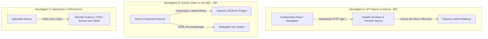

# Documentação Arquitetural: Migração para Next.js / React e Consumo de JSON Estático

## 1. Visão Geral e Objetivos da Transição

O projeto atual (**FinEdu**) opera como uma aplicação web multi-página baseada em HTML estático, CSS unificado e um arquivo monolítico de regras em JavaScript (`app.js`).

A evolução para o ecossistema **React com Next.js** busca os seguintes ganhos:
- **Modularização de Componentes**: Quebra de elementos repetidos (cabeçalhos, rodapés, barras de navegação móvel, cards de trilhas e componentes de feedback).
- **Renderização Otimizada**: Utilização de *Server Components* para o carregamento ultra-rápido de conteúdos textuais e SEO, reservando *Client Components* apenas para partes interativas (simulador, quiz e persistência local).
- **Roteamento Baseado em Sistema de Arquivos**: Substituição de múltiplos arquivos HTML por rotas estruturadas e dinâmicas com suporte nativo a transições suaves de página.
- **Camada de Dados Desacoplada**: Extração das perguntas, módulos de trilha e dados de simulação (atualmente embutidos no JavaScript) para estruturas JSON independentes, consumidas via API interna.

---

## 2. Estrutura e Organização Conceitual do Projeto

Na arquitetura moderna do Next.js (utilizando o modelo de *App Router*), os arquivos e responsabilidades são organizados hierarquicamente por pastas:

### Hierarquia de Pastas e Responsabilidades
- **Diretório Raiz de Aplicação**:
  - Centraliza o layout global (cabeçalho fixo, navegação mobile inferior e rodapé corporativo).
  - Define o arquivo de metadados principais (título da aplicação, descrições para motores de busca e favicon).
  - Agrupa os subdiretórios que correspondem a cada rota da aplicação.
- **Diretório de Componentes Reutilizáveis**:
  - **Componentes Estruturais**: Layout base, barra de progresso global, container de página e modais.
  - **Componentes do Quiz**: Cartão de pergunta, grupo de alternativas selecionáveis, botão de confirmação, painel de feedback explicativo e tela de pontuação final.
  - **Componentes do Simulador**: Painel de parâmetros (investimento inicial, aportes mensais, taxa e prazo), gráfico/tabela visual de evolução patrimonial e resumo comparativo de rentabilidade.
  - **Componentes de Trilhas e Conteúdo**: Cards de fases, marcadores de status (bloqueado, em andamento, concluído) e leitor de artigos educativos.
- **Diretório de Dados e Serviços**:
  - Armazenamento das fontes de dados JSON estáticas (conteúdos, módulos e banco de questões).
  - Módulos utilitários puros para cálculos matemáticos (fórmulas de juros compostos, cálculo de reserva de emergência e regras de pontuação).
- **Diretório de Recursos Estáticos (Públicos)**:
  - Hospedagem direta de imagens, ícones vetoriais, ilustrações dos módulos e arquivos estáticos que não exigem processamento pelo compilador.

---

## 3. Mapeamento de Rotas e Telas Atuais

| Página Atual (HTML) | Rota Conceitual no Next.js | Natureza do Componente | Responsabilidade Principal |
| :--- | :--- | :--- | :--- |
| `index.html` | `/` | Servidor (com ilhas de cliente) | Página inicial, apresentação da plataforma, atalhos rápidos e resumo de progresso do usuário |
| `pages/trilhas.html` | `/trilhas` | Servidor + Cliente | Exibição das fases de aprendizado e listagem dos módulos com status de conclusão |
| `pages/conteudo.html` | `/conteudo/[moduloId]` | Servidor | Leitura aprofundada dos artigos educativos sobre finanças com base no identificador selecionado |
| `pages/quiz.html` | `/quiz/[moduloId]` | Cliente (Interativo) | Execução interativa da avaliação: seleção de opções, cronometragem, conferência e avanço |
| `pages/simulador.html` | `/simulador` | Cliente (Interativo) | Formulário paramétrico em tempo real para cálculo de juros compostos e projeção de metas |

---

## 4. Guia Passo a Passo para Adição do Next.js e React

### Etapa 1: Planejamento e Inicialização do Ecossistema
1. Criação do workspace moderno com empacotamento compatível com React e suporte a convenções de Next.js.
2. Definição do sistema de estilos: preservação das variáveis de cores, espaçamentos e tipografia já existentes no CSS original, transportando-os para a folha de estilos global.
3. Configuração dos metadados de acessibilidade, viewport para dispositivos móveis e tags Open Graph para compartilhamento social.

### Etapa 2: Migração e Separação de Componentes
1. **Isolamento de Componentes Globais**:
   - Transformação do menu superior e da navegação inferior móvel em componentes compartilhados integrados ao layout principal.
2. **Classificação entre Servidor e Cliente**:
   - Componentes que não possuem estado interno nem eventos de clique complexos (ex.: cabeçalhos institucionais, rodapés e blocos de texto informativo) são configurados como componentes de servidor, garantindo carregamento instantâneo.
   - Componentes que dependem de interação contínua, digitação, seleção de alternativas ou temporizadores são isolados como componentes de cliente.

### Etapa 3: Migração das Regras de Negócio e Cálculos
1. Desacoplamento da lógica matemática do simulador (juros compostos, total investido e montante bruto/líquido), transformando-a em funções puras independentes de interface gráfica.
2. Centralização da lógica de progresso do usuário: substituição das chamadas diretas e espalhadas de armazenamento local por um mecanismo centralizado de estado ou contexto (permitindo sincronização reativa entre telas).

### Etapa 4: Validação Funcional e Otimizações
1. Teste de responsividade móvel: validação de comportamento em telas pequenas (drawer de navegação, botões de toque largo e legibilidade).
2. Validação de acessibilidade semântica: garantia do uso correto de cabeçalhos hierárquicos, textos alternativos e navegação por teclado.

---

## 5. Arquitetura de Consumo de API com JSON Estático

Atualmente, o banco de questões e a listagem de módulos residem como variáveis internas em um único arquivo de script. Abaixo são detalhadas as alternativas para transformar esse modelo em uma arquitetura de API limpa e desacoplada.

### Opções Arquiteturais

### Detalhamento das Abordagens

#### Abordagem A: Camada de API Interna (Route Handlers / BFF) — Recomendada para o Quiz
- **Como funciona**: O Next.js disponibiliza rotas dedicadas de API que funcionam no servidor. O cliente React solicita dados por chamadas assíncronas padrão.
- **Vantagem Estratégica**:
  - **Segurança de Gabarito**: No quiz, o cliente recebe apenas o enunciado e as opções. A resposta correta permanece protegida no servidor. Uma rota de verificação recebe a escolha do usuário e devolve apenas se ele acertou ou errou, impedindo que o aluno inspecione o código-fonte da página para ver as respostas corretas.
  - **Simplicidade de Manutenção**: A interface não precisa saber onde o JSON está fisicamente armazenado.

#### Abordagem B: Leitura Direta em Componentes de Servidor — Recomendada para Trilhas e Artigos
- **Como funciona**: Para conteúdos estáticos que não exigem sigilo (como a lista de módulos de aprendizagem e os textos explicativos), os componentes de servidor leem o arquivo JSON diretamente durante a geração da página.
- **Vantagem Estratégica**:
  - **Zero Latência de Rede**: Elimina a necessidade de fazer uma requisição HTTP interna entre cliente e servidor. O conteúdo já chega pronto no HTML final, maximizando o desempenho e o SEO.

#### Abordagem C: Armazenamento em CDN ou Repositório Externo
- **Como funciona**: O arquivo JSON é hospedado em um serviço externo (como GitHub Pages, Amazon S3 ou Cloudflare R2). A aplicação consome via endereço web público com políticas de cache configuradas.
- **Vantagem Estratégica**: Permite atualizar perguntas e textos de apoio sem a necessidade de gerar um novo pacote de publicação da aplicação inteira.

---

## 6. Proposta de Desenho Conceitual dos Endpoints da API

Para estruturar a comunicação com base em boas práticas REST, propõe-se a seguinte divisão de contratos de dados:

### 1. Endpoint de Trilhas e Módulos
- **Propósito**: Retornar a grade de aprendizado dividida por fases, contendo metadados de cada etapa (título, descrição curta, ícone temático e identificador único).
- **Uso na Interface**: Alimentação da página `/trilhas` e dos cards de atalho na tela inicial.

### 2. Endpoint de Conteúdo Educativo por Módulo
- **Propósito**: Receber um identificador de módulo e fornecer os blocos de conteúdo detalhados (títulos, seções explicativas, destaques e dicas conceituais).
- **Uso na Interface**: Alimentação dinâmica da página `/conteudo/[moduloId]`.

### 3. Endpoint de Perguntas do Quiz (Visão do Aluno)
- **Propósito**: Entregar a lista de perguntas do módulo requisitado contendo identificador da questão, enunciado e alternativas ordenadas.
- **Regra de Negócio**: **O índice da resposta correta e as dicas de gabarito são omitidos** da resposta entregue ao navegador, garantindo a lisura do teste pedagógico.

### 4. Endpoint de Validação do Quiz
- **Propósito**: Receber o identificador da questão e a opção escolhida pelo usuário. Retorna se a escolha foi satisfatória, a justificativa pedagógica/dica explicativa e a pontuação calculada.
- **Uso na Interface**: Acionado instantaneamente a cada resposta ou no envio final do questionário na página `/quiz/[moduloId]`.

### 5. Endpoint de Parâmetros de Mercado (Simulador)
- **Propósito**: Fornecer parâmetros de referência econômicos atualizados em formato estático (taxa básica de referência, rendimento padrão da poupança e percentual médio sugerido para reserva de emergência).
- **Uso na Interface**: Pré-preenchimento de valores padrão nos seletores e campos do simulador financeiro.

---

## 7. Estratégia de Cache, Resiliência e Experiência do Usuário

1. **Revalidação Incremental e Cache de Dados**:
   - Os dados estáticos devem possuir configuração de tempo de vida de cache no servidor, evitando processamento redundante a cada visita.
   - Em caso de alteração no arquivo JSON, mecanismos de revalidação baseados em etiquetas (*tags*) permitem purgar apenas a rota modificada sem afetar as demais.
2. **Estados de Carregamento Suaves**:
   - Enquanto os dados da API são processados, a interface exibe molduras visuais de pré-carregamento (*skeletons* com o formato de cartões e linhas cinzas) para manter a estabilidade visual e evitar saltos na tela (*layout shifts*).
3. **Tratamento de Falhas e Degradação Graciosa**:
   - Caso um arquivo JSON esteja temporariamente indisponível ou corrompido, a interface apresenta uma tela de contingência amigável com opção de tentar novamente, sem quebrar a navegação global.
4. **Persistência Híbrida de Progresso**:
   - O histórico de pontuações, medalhas e respostas concluídas do usuário pode continuar sendo armazenado no navegador (armazenamento local) para garantir funcionamento offline em dispositivos móveis, comunicando-se com a API apenas para validação e consulta dos enunciados.
